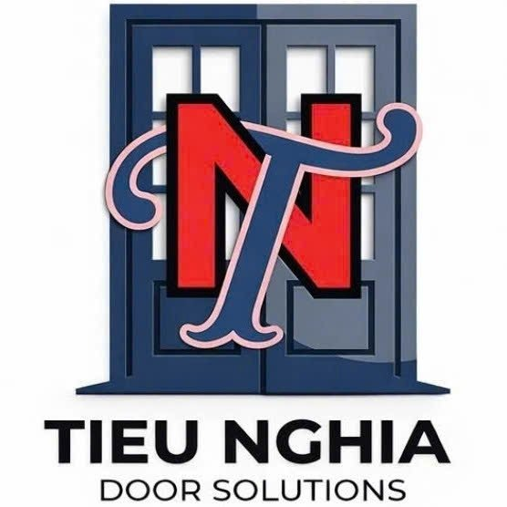
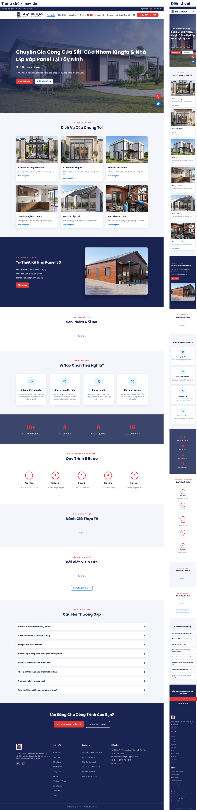
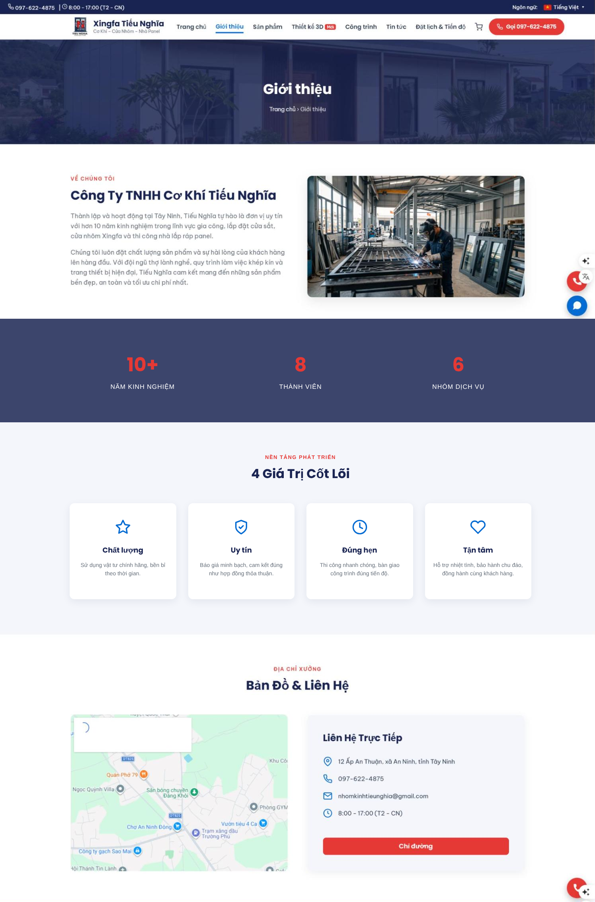
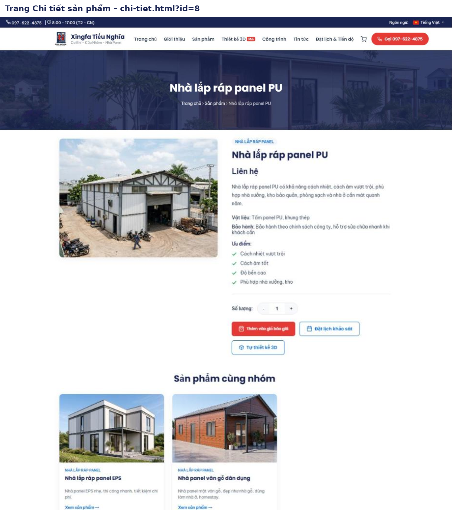
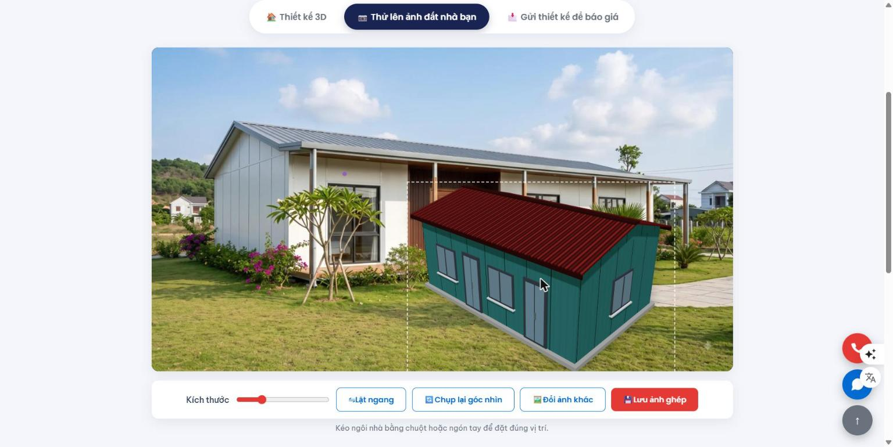
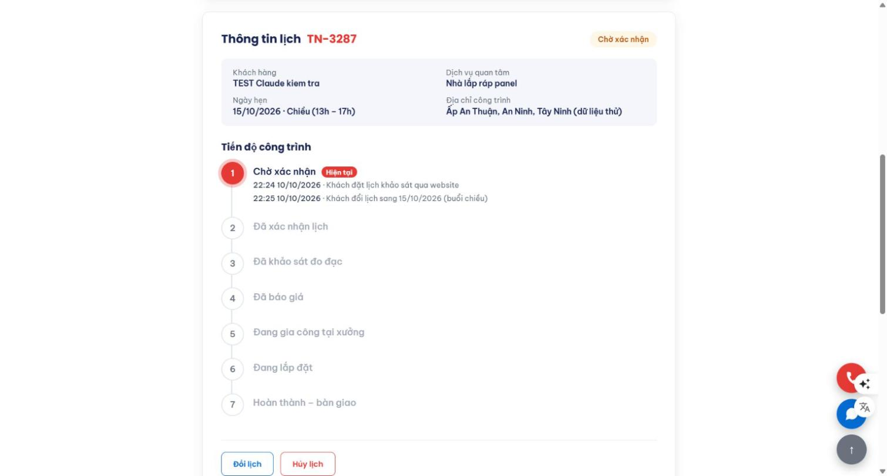
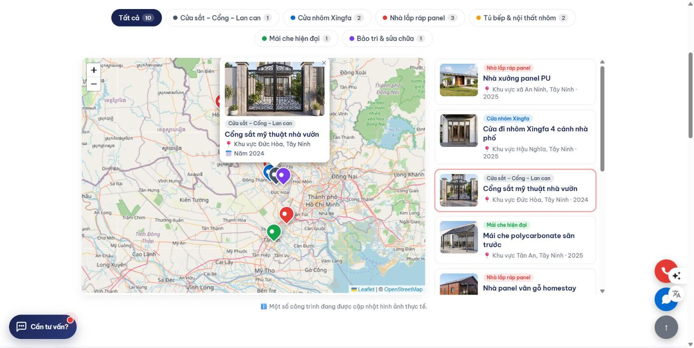
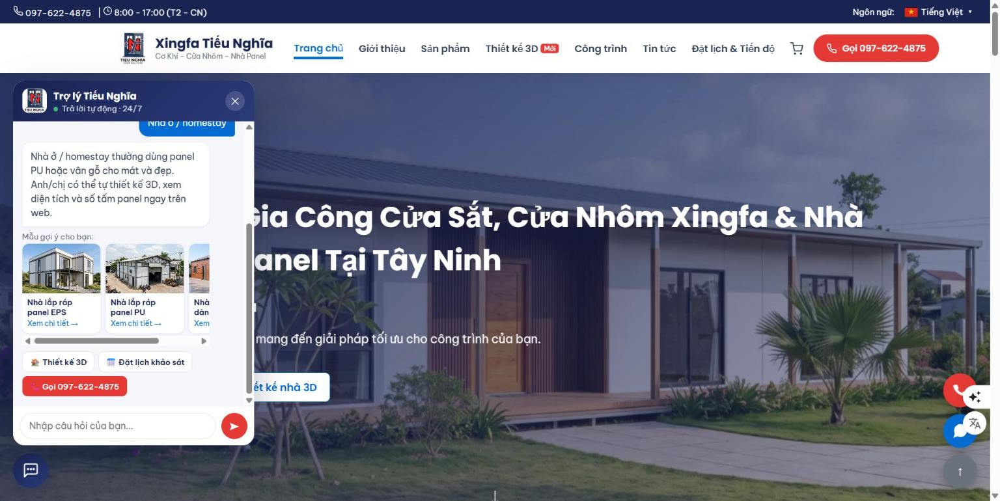
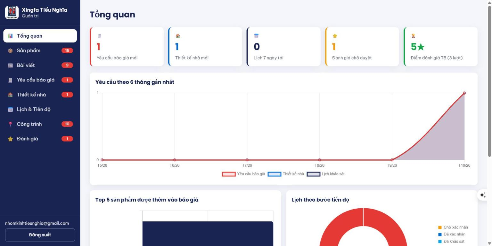

# BÁO CÁO ĐỒ ÁN CUỐI KHÓA – VIBE CODING

## Website Xingfa Tiếu Nghĩa – Thiết kế nhà panel 3D & đặt thi công trực tuyến

| | |
|---|---|
| Học viên | **Trương Thị Mai** |
| Đề tài | Website thương hiệu **Xingfa Tiếu Nghĩa** (Công ty TNHH Cơ Khí Tiếu Nghĩa) |
| Mã nguồn (Github) | https://github.com/nhomkinhtieunghia-sys/xingfa-tieunghia |
| Website (Github Pages) | https://nhomkinhtieunghia-sys.github.io/xingfa-tieunghia/ |
| Trang Quản trị (dành cho thầy chấm) | `https://nhomkinhtieunghia-sys.github.io/xingfa-tieunghia/admin.html` · Tài khoản chấm bài gửi riêng cho thầy kèm tin nhắn nộp bài |
| Công cụ AI | Claude (lên kế hoạch, soạn PRD/DESIGN/DATABASE, viết code Prompt 7–21, kiểm tra) · Google Antigravity (viết code Prompt 1–6) · Gemini API (tính năng dịch trong web) |
| Công nghệ | HTML · CSS · JavaScript thuần · Supabase · Three.js (3D) · Leaflet (bản đồ) · Chart.js (biểu đồ) · Github Pages |
| Ngôn ngữ website | Tiếng Việt · English · 中文 (giản thể) |

> Tài khoản Quản trị dành cho thầy là tài khoản riêng, tạo để chấm bài – sẽ xóa sau khi chấm xong. Khách xem web **không cần đăng nhập**; chỉ trang Quản trị (thêm/sửa/xóa dữ liệu) mới cần.

---

## 1. Mô tả dự án

**Lĩnh vực:** Cơ khí – xây dựng: gia công, lắp đặt cửa sắt, cổng, lan can; cửa nhôm Xingfa, cửa kính cường lực; nhà lắp ráp panel (EPS, PU); mái che; tủ bếp & nội thất nhôm; bảo trì sửa chữa.

**Thương hiệu:** **Xingfa Tiếu Nghĩa** – thương hiệu **có thật** của Công ty TNHH Cơ Khí Tiếu Nghĩa, 12 Ấp An Thuận, xã An Ninh, tỉnh Tây Ninh. Hotline/Zalo 0976 224 875. Website gốc: https://xingfatieunghia.com

**Mục tiêu website:** không chỉ giới thiệu công ty mà còn là **công cụ bán hàng thật**: khách tự **thiết kế nhà panel 3D**, thử ngôi nhà lên ảnh khu đất của mình, gửi yêu cầu báo giá, đặt lịch khảo sát và **theo dõi tiến độ công trình** trực tuyến; chủ doanh nghiệp có trang **quản trị + thống kê** để xử lý mọi yêu cầu.

**Điểm khác biệt so với landing page thông thường:**

| # | Tính năng | Giá trị cho khách / doanh nghiệp |
|---|---|---|
| 1 | Thiết kế nhà panel 3D | Khách tự chỉnh kích thước, panel, mái, màu, cửa và xoay xem 3D; web tự tính diện tích, số tấm panel |
| 2 | Thử nhà lên ảnh đất | Khách thấy trước ngôi nhà đặt trên khu đất của mình, lưu ảnh để bàn với gia đình |
| 3 | Theo dõi tiến độ | Khách biết công trình đang ở bước nào, không cần gọi hỏi |
| 4 | Trợ lý tư vấn | Trả lời câu hỏi thường gặp 24/7, gợi ý sản phẩm phù hợp |
| 5 | Bản đồ công trình | Tạo niềm tin: thấy công trình đã làm gần nhà mình |
| 6 | Đánh giá có duyệt | Khách để lại nhận xét, admin kiểm soát nội dung |
| 7 | Thống kê admin | Biết sản phẩm nào được quan tâm, lượng yêu cầu theo tháng |
| 8 | Hiệu ứng cao cấp | Trải nghiệm hiện đại, chuyên nghiệp |
| 9 | **3 ngôn ngữ Việt – Anh – Trung** | Phục vụ khách nước ngoài, chủ xưởng Trung Quốc ở khu công nghiệp; dịch cả sản phẩm, công trình, trợ lý |
| 10 | **Website 2 lớp: cho người và cho AI** | Ngoài giao diện cho người, web có lớp dữ liệu (`llms.txt`, schema.org, `sitemap.xml`) để ChatGPT, Gemini, Claude, Perplexity đọc hiểu đúng công ty khi khách hỏi AI – xu hướng tối ưu tìm kiếm bằng AI (GEO) |
| 11 | **Tin tức 3 ngôn ngữ + nút "Dịch bằng AI"** | Viết bài tiếng Việt, bấm 1 nút AI dịch sẵn tiếng Anh, tiếng Trung để duyệt rồi đăng; bản dịch lưu vào database nên khách xem nhiều cũng không tốn phí |

**Logo:** dùng **logo thật** của công ty (`assets/images/logo.jpg`, tải từ xingfatieunghia.com):

- Hình **cánh cửa 2 cánh màu xanh navy** → thể hiện ngành nghề chính là cửa.
- Ở giữa là **chữ "N" màu đỏ lồng chữ "T"** → viết tắt Tiếu – Nghĩa.
- Dòng chữ **"TIEU NGHIA – DOOR SOLUTIONS"** (giải pháp về cửa).
- Hai màu navy `#1A2452` và đỏ `#E53935` của logo được dùng làm **màu chủ đạo của toàn website** (xem `docs/DESIGN.md`).
- Logo dùng thống nhất 1 file ở header, footer và favicon của mọi trang.

**Hình ảnh:** toàn bộ ảnh sản phẩm là **ảnh thật** lấy từ website công ty (thư mục `assets/images/`).

---

## 2. Các trang trong dự án

Tất cả các trang dùng chung **menu (header)** và **chân trang (footer)** → bấm qua lại được giữa mọi trang.
Menu: Trang chủ · Giới thiệu · Sản phẩm · Đặt lịch khảo sát · Giỏ báo giá.

| # | Trang | File | Bố cục & nội dung |
|---|---|---|---|
| 1 | **Trang chủ** (Home) | `index.html` | Banner chuyển động + chữ gõ tự động · 6 nhóm dịch vụ · Khối "Tự thiết kế nhà panel 3D" · Sản phẩm nổi bật (database) · Vì sao chọn chúng tôi · Con số đếm tăng · Quy trình 5 bước · Đánh giá khách hàng (database) · Khối kêu gọi |
| 2 | **Về chúng tôi** (About) | `gioi-thieu.html` | Giới thiệu, sứ mệnh · Con số · 4 giá trị cốt lõi · **Google Maps** địa chỉ công ty + liên hệ |
| 3 | Sản phẩm | `san-pham.html` | Lưới sản phẩm từ database · lọc 6 nhóm · tìm kiếm |
| 4 | **Chi tiết sản phẩm** (Detail) | `chi-tiet.html?id=…` | Ảnh lớn, mô tả, vật liệu, ưu điểm, bảo hành, "Liên hệ" · thêm vào giỏ · nút Tự thiết kế 3D (nhóm nhà panel) · sản phẩm cùng nhóm |
| 5 | **Thiết kế nhà panel 3D** | `thiet-ke-nha.html` | Tab Thiết kế 3D (tùy chọn + mô hình xoay + bảng diện tích) · Tab Thử lên ảnh đất · Tab Gửi thiết kế báo giá |
| 6 | Công trình | `cong-trinh.html` | Bản đồ ghim công trình + danh sách · Đánh giá khách hàng + form gửi đánh giá |
| 6a | Tin tức | `tin-tuc.html` | Danh sách bài viết 3 ngôn ngữ, lọc chuyên mục, tìm kiếm, bài nổi bật |
| 6b | Chi tiết bài viết | `bai-viet.html?bai=…` | Nội dung bài, lượt xem, chia sẻ Facebook/Zalo, bài liên quan |
| 7 | Giỏ báo giá | `bao-gia.html` | Sửa số lượng, kích thước, xóa · form gửi yêu cầu |
| 8 | Đặt lịch & Tiến độ | `dat-lich.html` | Đặt lịch (nhận mã) · Tra cứu dòng thời gian tiến độ, đổi, hủy lịch |
| 9 | Quản trị | `admin.html` | Tổng quan (biểu đồ) · Sản phẩm · **Bài viết** (soạn Markdown, tải ảnh, nút Dịch bằng AI) · Yêu cầu báo giá · Thiết kế nhà · Lịch & Tiến độ · Công trình · Đánh giá |
| 10 | Dành cho AI | `ai.html` | Trang chữ tĩnh giới thiệu đầy đủ công ty cho AI đọc; nút Hỏi ChatGPT / Perplexity; link `llms.txt` |

Ngoài ra mọi trang có: thanh trên cùng với **"Ngôn ngữ:" + nút chọn 🇻🇳 / 🇬🇧 / 🇨🇳**, menu + footer chung, nút gọi/Zalo nổi, **trợ lý tư vấn** góc trái dưới.

**Ảnh chụp màn hình:** (chèn ảnh trong `docs/hinh-chup/`)

| Trang chủ | Về chúng tôi | Chi tiết sản phẩm |
|---|---|---|
|  |  |  |

| Thiết kế 3D | Thử lên ảnh đất | Tiến độ công trình |
|---|---|---|
|  |  |  |

| Công trình & đánh giá | Trợ lý tư vấn | Quản trị – Tổng quan |
|---|---|---|
|  |  |  |

---

## 3. Danh sách chức năng

**Cơ sở dữ liệu:** **Supabase** (PostgreSQL online), **8 bảng**: `bai_viet` · `san_pham` (15 sản phẩm) · `yeu_cau_bao_gia` · `thiet_ke_nha` · `lich_khao_sat` · `tien_do` · `cong_trinh` · `danh_gia`; 6 hàm RPC; bảo mật theo dòng (RLS); kho ảnh Storage `anh-web`; Edge Function `dich-ai` gọi Gemini. File tạo bảng `database/schema.sql`, dữ liệu mẫu `database/seed.sql`.

### 3.1. Đọc dữ liệu
| Mã | Chức năng | Trang |
|---|---|---|
| F01 | Sản phẩm nổi bật | Trang chủ |
| F02 | Danh sách sản phẩm, lọc nhóm, tìm tên | Sản phẩm |
| F03 | Chi tiết sản phẩm + cùng nhóm | Chi tiết |
| F04 | Đánh giá đã duyệt + điểm trung bình | Trang chủ, Công trình |
| F05 | Bản đồ + danh sách công trình | Công trình |

### 3.2. Thêm / Sửa / Xóa dữ liệu (insert – update – delete)
| Mã | Chức năng | Thao tác | Bảng |
|---|---|---|---|
| F06 | Giỏ báo giá: thêm, sửa, xóa | thêm/sửa/xóa (localStorage) | – |
| F07 | Gửi yêu cầu báo giá | **INSERT** | `yeu_cau_bao_gia` |
| F08 | Gửi thiết kế nhà 3D | **INSERT** | `thiet_ke_nha` |
| F09 | Đặt lịch khảo sát | **INSERT** | `lich_khao_sat`, `tien_do` |
| F10 | Đổi lịch | **UPDATE** | `lich_khao_sat` |
| F11 | Hủy lịch | **UPDATE** | `lich_khao_sat` |
| F12 | Khách gửi đánh giá | **INSERT** | `danh_gia` |
| F13 | Admin thêm / sửa / xóa sản phẩm | **INSERT / UPDATE / DELETE** | `san_pham` |
| F14 | Admin đổi trạng thái / xóa yêu cầu, thiết kế | **UPDATE / DELETE** | `yeu_cau_bao_gia`, `thiet_ke_nha` |
| F15 | Admin cập nhật tiến độ công trình | **UPDATE + INSERT** | `lich_khao_sat`, `tien_do` |
| F16 | Admin thêm / sửa / xóa công trình (chọn vị trí trên bản đồ) | **INSERT / UPDATE / DELETE** | `cong_trinh` |
| F17 | Admin duyệt / ẩn / xóa đánh giá | **UPDATE / DELETE** | `danh_gia` |
| F17a | Admin viết / sửa / xóa bài viết, tải ảnh lên | **INSERT / UPDATE / DELETE** | `bai_viet`, Storage |
| F17b | Đếm lượt xem bài viết | **UPDATE** | `bai_viet` |

### 3.3. Tính năng nổi bật
| Mã | Chức năng |
|---|---|
| F18 | **Thiết kế nhà panel 3D**: công năng, kích thước, loại panel, độ dày, kiểu mái, màu, cửa; xoay/phóng 3D; tính diện tích sàn, vách, mái, số tấm panel; chụp ảnh; chia sẻ link |
| F19 | **Thử nhà lên ảnh đất**: tải ảnh, kéo thả – phóng – lật ngôi nhà 3D, lưu ảnh ghép (xử lý ngay trên máy) |
| F20 | **Theo dõi tiến độ**: dòng thời gian 7 bước có ngày giờ, ghi chú |
| F21 | **Trợ lý tư vấn**: hội thoại theo kịch bản + nhận diện từ khóa, gợi ý sản phẩm từ database |
| F22 | **Thống kê admin**: thẻ số liệu, biểu đồ đường, cột, tròn (Chart.js) |
| F23 | **Hiệu ứng cao cấp**: màn hình chờ logo, banner Ken Burns, chữ gõ, số đếm, hiện dần khi cuộn |
| F29a | **3 ngôn ngữ**: nút chọn ngôn ngữ đầu trang; từ điển `assets/lang/vi.js, en.js, zh.js`; dữ liệu sản phẩm/công trình có cột dịch `_en`, `_zh`; lưu ngôn ngữ khách dùng khi gửi yêu cầu |
| F30 | **Lớp cho AI**: `llms.txt`, `llms-full.txt`, JSON-LD schema.org (doanh nghiệp, câu hỏi thường gặp), `robots.txt` cho phép bot AI, `sitemap.xml`, khối `<noscript>` – đọc được không cần JavaScript |
| F31 | **Câu hỏi thường gặp** ở trang chủ + trang **Dành cho AI** |
| F32 | **Tin tức 3 ngôn ngữ**: danh sách, chi tiết, bài liên quan, chia sẻ |
| F33 | **Soạn bài** Markdown có xem trước, lưu nháp / đăng, tải ảnh lên Supabase Storage |
| F34 | **Nút "Dịch bằng AI"**: Edge Function `dich-ai` gọi Gemini, khóa API cất trong Supabase Secrets, chỉ admin dùng được; dùng cho bài viết, sản phẩm, công trình |

### 3.4. Chức năng khác
| Mã | Chức năng |
|---|---|
| F24 | **Nhúng Google Maps** địa chỉ công ty (trang Về chúng tôi) |
| F25 | Nút nổi gọi điện + Zalo mọi trang |
| F26 | Responsive điện thoại, máy tính bảng, máy tính |
| F27 | Thông báo toast, hộp xác nhận trong trang |
| F28 | Kiểm tra dữ liệu form |
| F29 | Phân quyền Supabase (RLS): khách chỉ xem/gửi, admin mới sửa/xóa; khách không thể tự duyệt đánh giá |

---

## 4. Các file Markdown (.md) và tác dụng

| File | Tác dụng |
|---|---|
| `README.md` | Trang giới thiệu dự án trên Github: link web, danh sách trang, công nghệ, cấu trúc thư mục, cách chạy thử |
| `docs/PRD.md` | **PRD = Product Requirements Document (tài liệu yêu cầu sản phẩm).** Mô tả web *cần làm gì*: mục tiêu, thông tin công ty, 7 trang, danh sách chức năng, quy tắc kỹ thuật. AI đọc file này **trước khi viết code** để làm đúng và đủ, không tự bịa nội dung |
| `docs/DESIGN.md` | **Hướng dẫn giao diện:** màu sắc, font chữ, logo, hình ảnh, bố cục từng trang, hiệu ứng, cách dựng mô hình 3D và công thức tính diện tích, nút chọn ngôn ngữ, trang Dành cho AI, responsive. Giúp AI làm **mọi trang đồng nhất một phong cách**, đúng nhận diện thương hiệu |
| `docs/DATABASE.md` | Mô tả 8 bảng, cột, phân quyền, 6 hàm RPC, kho ảnh, Edge Function dịch và mẫu code truy vấn Supabase → AI viết code gọi đúng tên bảng, tên cột |
| `docs/PROMPTS.md` | Ghi lại **thứ tự các prompt** đã dùng và **kết quả** từng prompt |
| `supabase/functions/dich-ai/HUONG-DAN-TRIEN-KHAI.md` | Cách cài hàm Dịch bằng AI lên Supabase |
| `HUONG-DAN.md` | Hướng dẫn từng bước: tạo Github, Supabase, chạy prompt, deploy, nộp bài, đưa lên xingfatieunghia.com chạy thật |
| `BAO-CAO.md` | Báo cáo đồ án này |

**Cách làm việc:** soạn PRD + DESIGN + DATABASE trước → cho AI đọc → AI viết code theo tài liệu. Nhờ vậy prompt ngắn gọn, AI ít làm sai, và khi cần sửa chỉ cần sửa tài liệu rồi yêu cầu AI làm lại.

---

## 5. Lịch sử Prompt AI (theo thứ tự)

> Nội dung đầy đủ từng prompt xem trong `docs/PROMPTS.md`.

### Giai đoạn 1 – Lên kế hoạch & soạn tài liệu (với Claude)
| # | Prompt | Kết quả |
|---|---|---|
| 0.1 | Gửi đề bài của thầy, nhờ lên kế hoạch landing page cho công ty Xingfa Tiếu Nghĩa | Claude đề xuất 7 trang, dùng Supabase, deploy Github Pages; tạo `PRD.md`, `DESIGN.md`, `DATABASE.md`, `schema.sql`, `seed.sql`, `PROMPTS.md`, `HUONG-DAN.md`, `README.md` |
| 0.2 | Nhờ kiểm tra thư mục bài làm đã đủ yêu cầu của thầy chưa và chỉnh sửa để đạt điểm tối đa | Claude đối chiếu đề mới (thang điểm 3-3-2-0,5-0,5-0,5-0,5), phát hiện chưa có code; tải logo + 11 ảnh thật từ xingfatieunghia.com vào `assets/images/`, cập nhật tài liệu, tạo `BAO-CAO.md` và `.gitignore` |
| 0.3 | "Thêm vài ý để dự án khác biệt, không bị bình thường so với các bạn" | Claude đề xuất 12 ý; chọn 8 ý: thiết kế nhà panel 3D, thử nhà lên ảnh đất, theo dõi tiến độ, trợ lý tư vấn, bản đồ công trình, khách gửi đánh giá, thống kê admin, hiệu ứng cao cấp. Claude cập nhật PRD/DESIGN/DATABASE, mở rộng database lên 7 bảng + 5 hàm RPC (chạy thử trên PostgreSQL không lỗi), viết lại 17 prompt |
| 0.4 | Thêm 2 ý: (1) web có 2 phần – cho người tìm kiếm và cho AI lướt web; (2) đầu trang có "Ngôn ngữ:" + nút chọn Anh – Việt – Trung | Claude làm rõ ý 1 là tối ưu cho AI (llms.txt, schema.org, robots.txt, sitemap.xml, trang Dành cho AI); ý 2 chọn tiếng Trung giản thể, dịch cả dữ liệu database. Thêm cột dịch + cột ngôn ngữ vào database, dịch sẵn 15 sản phẩm + 10 công trình, thêm prompt 16–17, thêm kế hoạch đưa lên xingfatieunghia.com |
| 0.5 | "Sau này viết bài tiếng Việt có tự đổi sang tiếng Trung không?" → thêm trang Tin tức 3 ngôn ngữ + nút "Dịch bằng AI" | Claude giải thích bản dịch lưu sẵn trong database nên khách xem không tốn phí, Gemini gói miễn phí đủ dùng; thêm bảng `bai_viet`, kho ảnh, Edge Function `dich-ai`, 3 bài viết mẫu, prompt 16–17, hướng dẫn lấy khóa Gemini |

### Giai đoạn 2 – Viết code (Prompt 1–6: Antigravity · Prompt 7–21: Claude làm AI agent theo đúng prompt)

> Prompt 1–6 chị Mai dán vào Antigravity, Claude kiểm tra trên Chrome và viết prompt phụ khi có lỗi. Từ Prompt 7, theo yêu cầu của chị Mai, Claude tự viết code theo nội dung prompt, tự mở web kiểm tra, chụp màn hình và ghi kết quả.
| # | Prompt | Kết quả |
|---|---|---|
| 1 | Đọc PRD/DESIGN/DATABASE, dựng khung 9 trang, `style.css`, `config.js`, `layout.js` | 31 file: 12 trang, CSS/JS chung, 3 file ngôn ngữ, menu – footer – nút ngôn ngữ dùng chung. Prompt phụ 1a–1d: sửa ngôn ngữ bị mất khi chuyển trang, bản đồ bị ẩn |
| 2 | Trang chủ + hiệu ứng cao cấp (`hieu-ung.js`) | Đủ 10 khối trang chủ, hiệu ứng Ken Burns, chữ gõ, số đếm, hiện dần khi cuộn. Prompt phụ 2a |
| 3 | Trang Về chúng tôi + nhúng Google Maps | Giới thiệu, sứ mệnh, 4 giá trị, Google Maps 12 Ấp An Thuận + nút Chỉ đường. Prompt phụ 3a |
| 4 | Kết nối Supabase + trang Sản phẩm + sản phẩm nổi bật, đánh giá ở trang chủ | Nối Supabase, 15 sản phẩm, lọc nhóm, tìm tên. Prompt phụ 4a–4c: AI đặt sai tên cột → sửa theo DATABASE.md; thay ảnh trùng |
| 5 | Trang Chi tiết sản phẩm + thêm vào giỏ | Chi tiết, giỏ, sản phẩm cùng nhóm. Prompt phụ 5a: thêm khóa chữ còn thiếu |
| 6 | Giỏ báo giá + gửi yêu cầu báo giá (INSERT) | **INSERT** `yeu_cau_bao_gia` thành công. Sự cố hỏng mã hóa chữ do PowerShell → Claude khôi phục. Prompt phụ 6a, 6b |
| 7 | Đặt lịch (INSERT), tra cứu dòng thời gian tiến độ, đổi/hủy lịch (UPDATE) | **INSERT** lịch (mã TN-3287), tra cứu dòng thời gian 7 bước, **UPDATE** đổi lịch, **UPDATE** hủy lịch – thử thật trên Supabase. Prompt phụ 7a |
| 8 | Thiết kế nhà panel 3D – mô hình + tùy chọn + tính diện tích | Mô hình 3D Three.js, 5 công năng, tính diện tích đúng công thức (kiểm tra tay).  |
| 9 | Thiết kế 3D – chụp ảnh, chia sẻ link, gửi thiết kế báo giá (INSERT) | Chụp ảnh, chia sẻ link `?tk=` nạp đúng thiết kế, **INSERT** thiết kế (mã TK-49062). Prompt phụ 9a, 9b |
| 10 | Thử nhà lên ảnh đất của khách | Ghép nhà 3D (nền trong suốt, giữ bóng) lên ảnh đất, kéo thả, co giãn, lật, lưu ảnh JPG |
| 11 | Trang Công trình: bản đồ Leaflet + gửi đánh giá (INSERT) | Bản đồ 10 ghim, lọc, popup; **INSERT** đánh giá chờ duyệt. Prompt phụ 11a (chống chèn mã), 11b |
| 12 | Trợ lý tư vấn tự động | Trợ lý 3 ngôn ngữ, 5 nhánh, nhận diện từ khóa Việt/Anh/Trung, gợi ý sản phẩm. Prompt phụ 12a |
| 13 | Quản trị 1: đăng nhập, sản phẩm (INSERT/UPDATE/DELETE), báo giá, thiết kế | Đăng nhập, 8 mục; sản phẩm **INSERT/UPDATE/DELETE**, báo giá & thiết kế **UPDATE/DELETE** |
| 14 | Quản trị 2: cập nhật tiến độ, công trình, duyệt đánh giá | Tiến độ **UPDATE + INSERT**, công trình **INSERT/UPDATE/DELETE** chọn vị trí trên bản đồ, duyệt đánh giá **UPDATE/DELETE** |
| 15 | Quản trị 3: Tổng quan & biểu đồ (Chart.js) | 5 thẻ số liệu, biểu đồ đường / cột / tròn, lịch 7 ngày. Prompt phụ 15a |
| 16 | Trang Tin tức & chi tiết bài viết (Markdown) | Tin tức lọc, tìm, nổi bật, phân trang; chi tiết Markdown an toàn, lượt xem, chia sẻ, bài liên quan |
| 17 | Quản trị bài viết + nút "Dịch bằng AI" (Edge Function + Gemini) | Edge Function `dich-ai` (Gemini), nút Dịch bằng AI dùng chung, soạn bài toàn màn hình **INSERT/UPDATE/DELETE** |
| 18 | Dịch toàn bộ sang tiếng Anh & tiếng Trung giản thể | Thêm 98 khóa EN/中文; kiểm tra 11 trang × 3 ngôn ngữ: 0 lỗi, 0 khóa thô |
| 19 | Website 2 lớp: llms.txt, schema.org, robots.txt, sitemap.xml, trang Dành cho AI | llms.txt, llms-full.txt, JSON-LD 11 trang, robots.txt, sitemap.xml, noscript, trang Dành cho AI; tắt JS vẫn đọc được |
| 20 | Kiểm tra liên kết, responsive, sửa lỗi | 11 trang × 3 ngôn ngữ × máy tính/điện thoại: 0 lỗi; không link hỏng; sửa ảnh nền, camera 3D điện thoại |
| 21 | Cập nhật README, kiểm tra đường dẫn, chuẩn bị deploy | README, HUONG-DAN cập nhật; đường dẫn tương đối, sẵn sàng deploy |

> Các prompt sửa lỗi phát sinh (nếu có) ghi thêm dạng 2a, 5a… ngay dưới prompt tương ứng.

### Giai đoạn 3 – Đưa lên Github & Deploy
| Bước | Kết quả |
|---|---|
| Push code lên repo Public `xingfa-tieunghia` | Lần đầu push bằng Antigravity bị lỗi 403 (máy nhớ đăng nhập tài khoản Github cũ) → xóa thông tin đăng nhập cũ trong Windows Credential Manager, đăng nhập tài khoản `nhomkinhtieunghia-sys` bằng GitHub Desktop → **Publish branch** thành công. Repo: https://github.com/nhomkinhtieunghia-sys/xingfa-tieunghia |
| Bật Github Pages (branch main, /root) | Web chạy được: https://nhomkinhtieunghia-sys.github.io/xingfa-tieunghia/ — Claude kiểm tra trên web thật (11/10/2026): 15 trang/tệp đều trả 200, đọc được dữ liệu Supabase (15 sản phẩm, 10 công trình, 3 bài viết, 3 đánh giá), 3D chạy, bản đồ hiện 10 ghim, trang Quản trị hiện form đăng nhập, không có lỗi console |

---

## 6. Tự đánh giá theo tiêu chí của thầy

| Tiêu chí | Điểm | Đạt |
|---|---|---|
| 1. Trang Chủ, Về Chúng Tôi, Chi tiết sản phẩm (+9 trang) | 3 | ☑ |
| 2. Có database Supabase (8 bảng + kho ảnh + Edge Function) | 3 | ☑ |
| 3. ≥ 2 chức năng insert/update/delete (có 12 chức năng F07–F17) | 2 | ☑ |
| 4. Nhúng Google Maps | 0,5 | ☑ |
| 5. Dùng file .md | 0,5 | ☑ |
| 6. Github Public | 0,5 | ☑ |
| 7. Deploy Github Pages | 0,5 | ☑ |
| Các trang liên kết với nhau (không bị trừ) | – | ☑ |
| Logo + hình ảnh thật của thương hiệu (không bị trừ) | – | ☑ |
| Điểm cộng sáng tạo: 3D, thử ảnh, tiến độ, trợ lý, bản đồ, đánh giá, thống kê, 3 ngôn ngữ, lớp cho AI, tin tức + Dịch bằng AI | – | ☑ |
