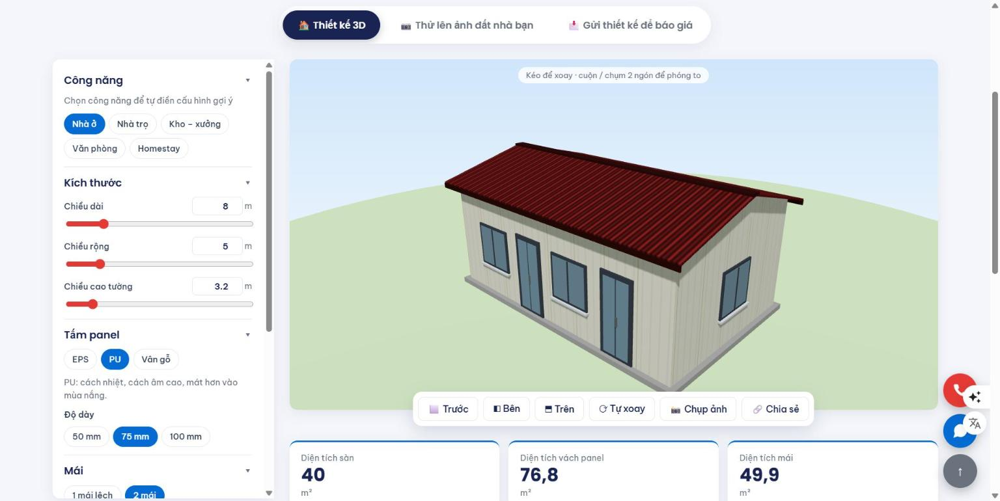

# Xingfa Tiếu Nghĩa – Tóm tắt đồ án (đọc trong 2 phút)

Website thật của **Công ty TNHH Cơ Khí Tiếu Nghĩa** (Tây Ninh): cửa sắt, cửa nhôm Xingfa, nhà lắp ráp panel, mái che, tủ bếp nhôm.
Học viên: **Trương Thị Mai** · Logo và hình ảnh là của công ty.

- 🌐 **Website:** https://nhomkinhtieunghia-sys.github.io/xingfa-tieunghia/
- 🔐 **Trang quản trị:** https://nhomkinhtieunghia-sys.github.io/xingfa-tieunghia/admin.html (tài khoản chấm gửi kèm tin nhắn)
- 📄 Báo cáo chi tiết: [BAO-CAO.md](BAO-CAO.md)

---

## ⭐ 3 điểm nổi bật

### 1. Tự thiết kế nhà panel 3D
Khách tự chọn công năng, kích thước, số phòng, màu mái, màu tường, cửa. Ngôi nhà 3D thay đổi ngay trên màn hình và có thể xoay hoặc phóng to. Khách có thể đặt nhà vào **ảnh chụp mảnh đất của mình** để xem trước, rồi gửi thiết kế cho công ty báo giá.

👉 Thử: [thiet-ke-nha.html](https://nhomkinhtieunghia-sys.github.io/xingfa-tieunghia/thiet-ke-nha.html)

### 2. Ba ngôn ngữ: Việt – Anh – Trung
Nút **Ngôn ngữ** ở đầu trang đổi toàn bộ giao diện, kể cả **dữ liệu trong database** (sản phẩm, công trình, bài viết). Khi soạn bài viết mới, nút **🌐 Dịch bằng AI** (Gemini) dịch sẵn sang tiếng Anh và tiếng Trung chỉ bằng 1 lần bấm.

👉 Thử: bấm nút **Ngôn ngữ** ở góc phải trên của bất kỳ trang nào, chọn English hoặc 中文.

### 3. Website 2 lớp – cho người xem và cho AI tìm kiếm
Hiện nay khách hay hỏi ChatGPT, Gemini, Perplexity: *"Làm cửa nhôm Xingfa ở Tây Ninh chỗ nào?"*. Web có thêm một lớp riêng để **AI đọc hiểu đúng thông tin công ty** (tối ưu tìm kiếm bằng AI – GEO):

| Tệp | Tác dụng |
|---|---|
| [`llms.txt`](https://nhomkinhtieunghia-sys.github.io/xingfa-tieunghia/llms.txt) | "Danh thiếp cho AI": tóm tắt công ty, dịch vụ, liên hệ |
| [`llms-full.txt`](https://nhomkinhtieunghia-sys.github.io/xingfa-tieunghia/llms-full.txt) | Bản đầy đủ: 15 sản phẩm, quy trình, câu hỏi thường gặp |
| Schema.org (JSON-LD) | Gắn trên 11 trang để Google và AI hiểu đây là doanh nghiệp, địa chỉ, giờ mở cửa |
| [`robots.txt`](https://nhomkinhtieunghia-sys.github.io/xingfa-tieunghia/robots.txt) + [`sitemap.xml`](https://nhomkinhtieunghia-sys.github.io/xingfa-tieunghia/sitemap.xml) | Cho phép bot AI vào đọc, chỉ đường tới mọi trang |
| [`ai.html`](https://nhomkinhtieunghia-sys.github.io/xingfa-tieunghia/ai.html) | Trang chữ thuần, có nút "Hỏi ChatGPT / Perplexity về công ty" |

👉 Thử: mở trang [Dành cho AI](https://nhomkinhtieunghia-sys.github.io/xingfa-tieunghia/ai.html) và bấm nút hỏi ChatGPT.

---

## ✅ Đối chiếu tiêu chí chấm

| Tiêu chí | Điểm | Ở đâu |
|---|---|---|
| Trang chủ, Về chúng tôi, Chi tiết sản phẩm | 3 | `index.html`, `gioi-thieu.html`, `chi-tiet.html` (+ 9 trang khác, liên kết qua menu) |
| Database | 3 | Supabase: 8 bảng, kho ảnh, Edge Function dịch AI |
| Thêm / sửa / xóa | 2 | Khách: gửi báo giá, đặt lịch, đổi/hủy lịch, gửi thiết kế, gửi đánh giá · Quản trị: thêm/sửa/xóa sản phẩm, bài viết, công trình, cập nhật tiến độ, duyệt đánh giá |
| Google Maps | 0,5 | Nhúng ở trang Giới thiệu; trang Công trình có thêm bản đồ ghim 10 công trình |
| File .md | 0,5 | `README`, `PRD`, `DESIGN`, `DATABASE`, `PROMPTS`, `BAO-CAO`, `HUONG-DAN`, `TOM-TAT` |
| Github Public | 0,5 | https://github.com/nhomkinhtieunghia-sys/xingfa-tieunghia |
| Deploy | 0,5 | Github Pages (link ở đầu trang) |

**Tính năng thêm:** đặt lịch khảo sát và theo dõi tiến độ bằng mã lịch · bản đồ công trình và đánh giá có duyệt · trợ lý tư vấn · tin tức · trang quản trị có biểu đồ thống kê.
